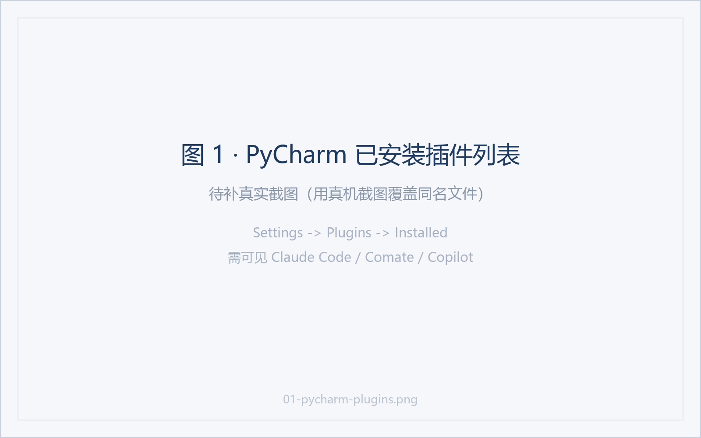
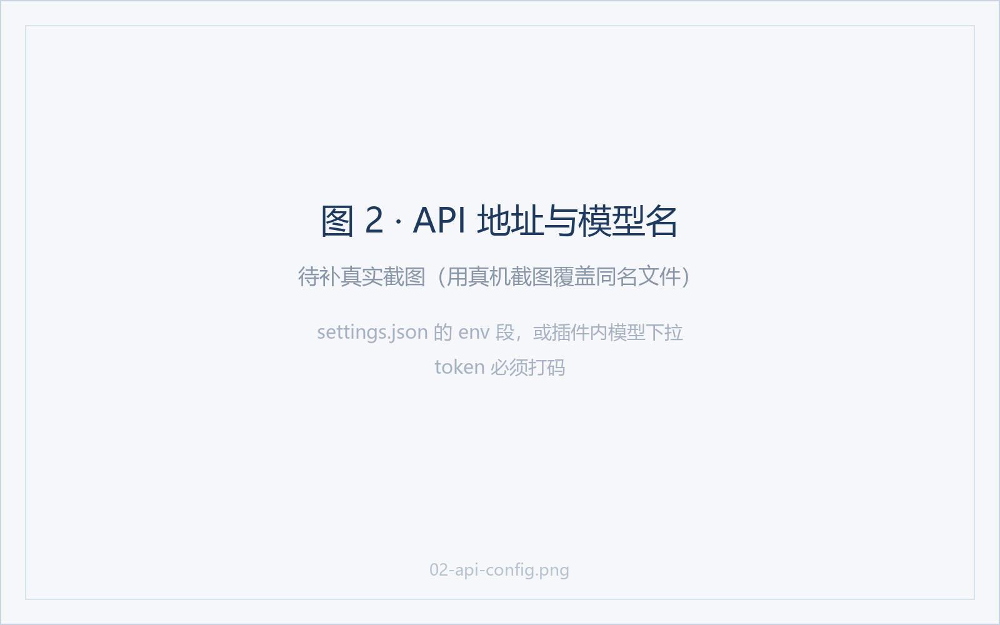
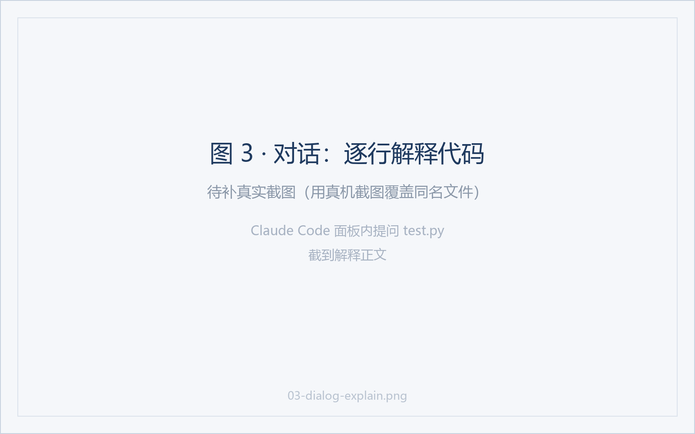
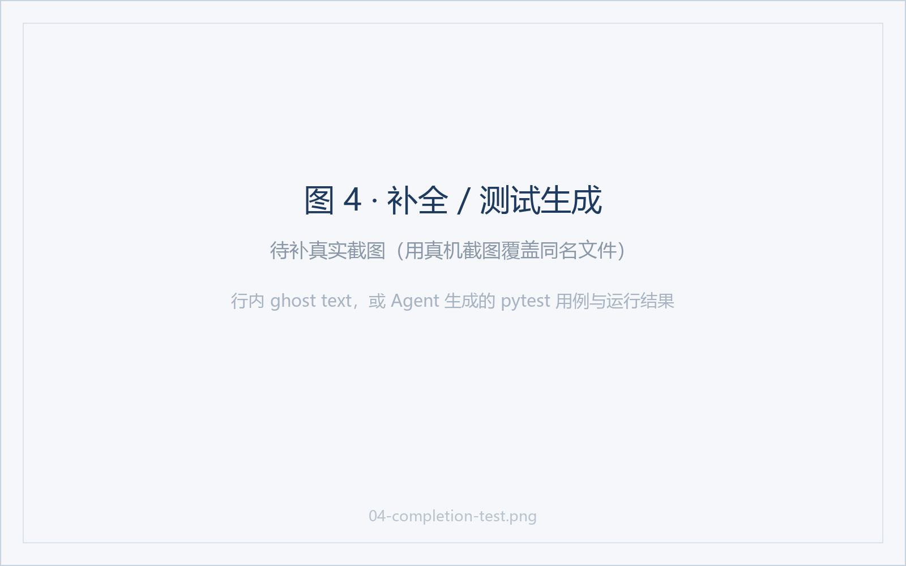
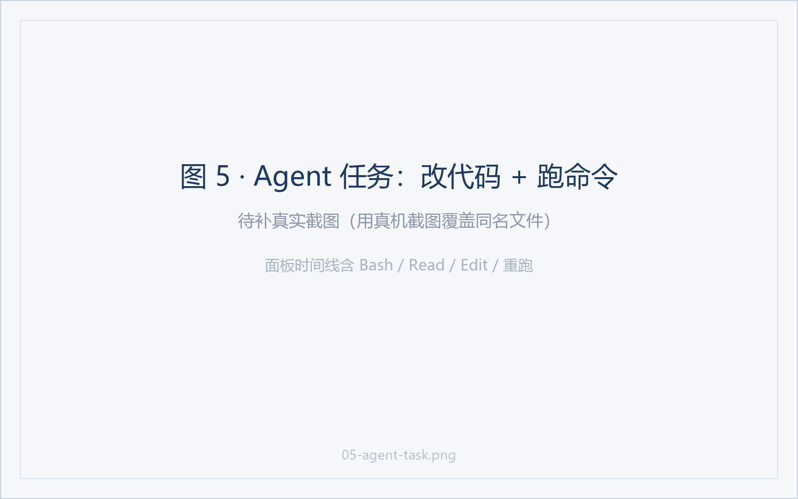

# PyCharm AI 编程助手配置操作指南手册

**方案二：桌面 Agent + IDE 插件模式（Claude Code Agent + PyCharm 插件）**

> 适用场景：围绕「人岗匹配系统」进行源码研读与二次开发，需要 AI 在 IDE 内完成**代码解释、补全、测试生成与跨文件任务自动化**。

---

## 一、封面

| 项目 | 内容 |
| --- | --- |
| 实验名称 | 为 PyCharm 配置 AI 编程助手（源码研读与二次开发支撑） |
| 姓名 | 肖俊涛 |
| 学号 | 2405100606 |
| 所选方案 | 方案二：桌面 Agent + IDE 插件模式 |
| 工具名称 | Claude Code（Agent 主程序，v2.1.283）+ PyCharm 插件「Claude Code」（插件包 `idea-claude-code-gui` v0.5.7） |
| IDE 版本 | PyCharm 2026.2.2，Build `PY-262.10315.174` |
| 操作系统 | Windows（x64），Node.js v24.17.0 |
| 完成日期 | 2026-10-21 |

---

## 二、选型理由与环境说明

### 2.1 为什么是「方案二」

任务书给了两条路线：**方案一**是纯 IDE 插件（Continue / CodeGPT / Cline / aiXcoder / JetBrains AI Assistant / 通义灵码），**方案二**是桌面 Agent 主程序 + IDE 插件窗口。

本次选方案二，理由有三条，都是围绕「人岗匹配系统源码研读」这个真实目标来的：

1. **研读一个陌生工程，第一步不是补全一个函数，而是"把整条链路读出来"。** 方案一的插件能解释当前文件、当前选中片段，但跨文件追踪（`resume_parser.py → matcher.py → api.py` 这种调用链）要靠人一次次喂上下文；方案二的 Agent 可以自己 `Read`/`Grep` 一遍目录，把链路整理成文档再交给我。
2. **研读之后紧接着是二次开发：改代码、加用例、跑测试。** 这类动作是"任务级"的——需要连续执行多条命令、根据报错回头改文件。这正是 Agent 主程序（Claude Code CLI）的强项：它在本机执行 `Read / Write / Edit / Bash`，插件只负责把结果渲染回 IDE。
3. **API 可以统一收口。** Agent 侧一份 `settings.json` 就能把端点、密钥、模型别名定死（本次接的是 Anthropic 兼容端点），IDE 侧不用再各自配一遍，换模型时只改一处。

一句话概括选型逻辑：**行级、跟随光标的工作交给 IDE；任务级、跨文件的工作交给 Agent。方案二两者都有，方案一只有前者。**

### 2.2 两个方案在本机的对照物

本机同时装了方案一的三款纯插件（百度 Comate 4.14.0、GitHub Copilot 1.17.0、Qoder CN 2026.917），因此后续对比不是查资料得出的，而是同一台机器、同一个项目里跑出来的（详见 `02-对比分析报告.md`）。

### 2.3 环境清单

| 组件 | 版本 / 路径 | 备注 |
| --- | --- | --- |
| PyCharm | 2026.2.2（`D:\Program Files\JetBrains\PyCharm 2026.2.2`） | Build `PY-262.10315.174` |
| PyCharm 配置目录 | `C:\Users\16218\AppData\JetBrains\PyCharm2026.2` | 插件装在其 `plugins\` 下 |
| Python 解释器 | conda 环境 `pycharmprojects`，Python 3.13.15 | 项目 SDK 指向该环境 |
| Node.js | v24.17.0 | Claude Code CLI 的运行前提 |
| Claude Code CLI | `C:\Users\16218\AppData\Roaming\npm\claude.ps1`，`2.1.283` | Agent 主程序 |
| PyCharm 插件 | `idea-claude-code-gui` v0.5.7 | 交互窗口 + 桥接层 |
| 工程目录 | `G:\PycharmProjects` | 本次实测项目 |
| API 端点 | `https://api.deepseek.com/anthropic` | Anthropic 协议兼容 |
| 模型 | `deepseek-flash`（经别名映射） | 见 4.2 |

---

## 三、详细安装步骤

> 顺序不能反：**先装 Agent（CLI），再装 IDE 插件**。插件启动时要去找 CLI，找不到就是一块空白面板。

### 3.1 前置检查

打开 PowerShell，确认 Node 可用（Claude Code 依赖 Node 18+）：

```powershell
node -v          # v24.17.0
npm -v
```

若 `node` 不存在，先装 Node.js LTS（本次为 v24.17.0），装完**重开终端**让 PATH 生效。

### 3.2 安装 Claude Code CLI（Agent 主程序）

```powershell
npm install -g @anthropic-ai/claude-code
claude --version     # 期望输出 2.1.283 (Claude Code)
claude doctor        # 可选：自检安装、网络与鉴权
```

安装后 CLI 落在 `C:\Users\<用户名>\AppData\Roaming\npm\claude.ps1`。**这一步装的是"能力"**：文件读写、命令执行、多步任务编排都在这里，IDE 插件装不装它都在。

### 3.3 在 PyCharm 中安装插件

1. 打开 PyCharm → `Ctrl+Alt+S` → **Plugins** → `Marketplace`；
2. 搜索 **Claude Code**，选中后点 `Install`；
3. 安装完成后 **Restart IDE**（不重启不会出现工具窗口）；
4. 重启后右侧边栏出现 **Claude Code** 工具窗口按钮。

安装位置（用于排错）：`C:\Users\16218\AppData\JetBrains\PyCharm2026.2\plugins\idea-claude-code-gui`，插件清单声明兼容 `since-build=233 / until-build=263.*`，与本机 262.x 匹配。



> 图 1：`Settings → Plugins → Installed`，可见 Claude Code（方案二的核心件）与 Comate / Copilot（方案一的对照件）。

### 3.4 打开面板并与工程建立关联

1. 打开工程 `G:\PycharmProjects`；
2. 点击右侧 **Claude Code** 图标打开面板；
3. 面板首次启动会在项目下写状态文件 `G:\PycharmProjects\.idea\claudeCodeTabState.xml`，其中记录 `provider=claude`、`model=claude-sonnet-5[1m]`、`permissionMode=default`、`cwd=G:\PycharmProjects`——**这行记录就是"插件已和 Agent 握手成功"的证据**；
4. 底部状态区显示当前工程目录与模型名，即可开始对话。

---

## 四、配置步骤（API 地址、模型名、角色分工）

### 4.1 API 地址与鉴权

配置写在 Agent 侧的用户级文件：`C:\Users\16218\.claude\settings.json`。核心是 `env` 段：

```json
{
  "env": {
    "ANTHROPIC_BASE_URL": "https://api.deepseek.com/anthropic",
    "ANTHROPIC_AUTH_TOKEN": "sk-****（已脱敏，请勿提交到仓库）",
    "ANTHROPIC_MODEL": "deepseek-flash",
    "ANTHROPIC_DEFAULT_SONNET_MODEL": "deepseek-flash",
    "ANTHROPIC_DEFAULT_OPUS_MODEL": "deepseek-flash",
    "ANTHROPIC_DEFAULT_HAIKU_MODEL": "deepseek-flash"
  }
}
```

三个要点：

- **BASE_URL 走 Anthropic 协议**（`/anthropic` 后缀），不是 OpenAI 的 `/v1`，路径写错会直接 404；
- **AUTH_TOKEN 用 `sk-` 形式的第三方密钥**，不走 `claude login` 的网页 OAuth；
- 修改后**重启 IDE 或新开面板会话**才生效。



> 图 2：`settings.json` 中的端点与模型别名（token 已打码）。

### 4.2 模型名与别名映射

插件 UI 的模型下拉显示的是 Anthropic 的家族名（Sonnet / Opus / Haiku），实际请求打到第三方端点时，由 `ANTHROPIC_DEFAULT_*_MODEL` 翻译成真实模型名：

| 插件 UI 显示 | 环境变量 | 实际模型 |
| --- | --- | --- |
| Sonnet | `ANTHROPIC_DEFAULT_SONNET_MODEL` | `deepseek-flash` |
| Opus | `ANTHROPIC_DEFAULT_OPUS_MODEL` | `deepseek-flash` |
| Haiku（后台小任务） | `ANTHROPIC_DEFAULT_HAIKU_MODEL` | `deepseek-flash` |
| 兜底 | `ANTHROPIC_MODEL` | `deepseek-flash` |

> 实测提醒：`ANTHROPIC_MODEL` 只对命令行直接调用生效，**插件里仍然要选一个家族名**；判断"到底用的哪个模型"不要看下拉框，要看网关回显。本机历史会话的计费记录里，服务端回显的是 `DeepSeek-V4-Pro`（input 30799 tokens / output 327 tokens，单轮成本约 $0.29），说明网关侧的模型名与配置里的别名不必一致——**以接口回显为准**。

### 4.3 角色分工

| 角色 | 承担什么 | 具体位置 |
| --- | --- | --- |
| **IDE（PyCharm）** | 解释器与依赖、断点调试、运行配置、Git 变更视图、语法/类型诊断 | `D:\Program Files\JetBrains\PyCharm 2026.2.2` |
| **IDE 插件（Claude Code GUI）** | 交互窗口：会话渲染、把当前文件/选中代码/诊断信息作为上下文送出去、把 Agent 的改动以 diff 形式回填 | `…\plugins\idea-claude-code-gui` v0.5.7 |
| **Agent（Claude Code CLI）** | 真正的执行者：读文件、写文件、跑命令、多步任务编排、失败重试 | `…\Roaming\npm\claude.ps1` v2.1.283 |

**一句话记法：IDE 给上下文，插件给界面，Agent 给手和脚。**

### 4.4 配置生效验证

```powershell
claude -p "用一句话说明你当前使用的模型" --output-format text
```

能返回文本即说明端点、密钥、模型三者都通；若返回 401 → 密钥问题，404/model not found → 模型名或 BASE_URL 路径问题（见 6.3）。

---

## 五、功能验证（三类场景）

### 5.1 场景一：对话 —— 代码逐行解释

**操作：** 打开 `G:\PycharmProjects\test.py`（KMeans 聚类示例），全选后向 Claude Code 面板提问：

> 为我解释每一行代码作用以及每一个包每一个函数是干什么的

**预期结果：** Agent 返回分层的解释——`make_blobs` 造四簇样本（`n_features=2` 是为二维可视化服务）、`KMeans(n_clusters=4, random_state=9).fit_predict(X)` 一步完成"拟合 + 打标签"、`cluster_std=[0.4,0.2,0.2,0.2]` 制造疏密不一的簇，最后 `plt.scatter(..., c=y_pred)` 按簇着色。**关键点是它会把"为什么 n_features=2"和"为什么 centers 必须是 4 个 2 维点"这种隐含约束讲出来**，这是纯补全插件给不了的。



> 图 3：Claude Code 面板内逐行解释（对话类验证）。

### 5.2 场景二：补全与测试生成

**补全（行级，对照方案一）：** 在 `test.py` 里写到 `y_pred = KMeans(` 时，Comate / Copilot 会给出整行的 ghost text，`Tab` 接受即可。这是方案一的主场，行内、零切换成本。

**测试生成（任务级，方案二）：** 在 Claude Code 面板说：

> 给 test.py 里的聚类流程写 pytest 用例，覆盖「簇数量为 4」和「每个样本都有标签」两点，写到 test_kmeans.py 并运行

Agent 会自己创建 `test_kmeans.py`、写断言、执行 `pytest`，把结果贴回面板；失败时会读报错、改断言、再跑一遍。



> 图 4：上半为行内补全，下半为 Agent 生成的 pytest 用例及运行结果。

### 5.3 场景三：Agent 任务 —— 改代码 + 跑命令（闭环）

**操作：** 在面板输入一个"任务"而不是"问题"：

> 跑一下 test.py；如果报错就定位并修好，改完再跑一次确认

**预期结果：** 面板时间线依次出现 `Bash`（执行 `python test.py`）→ 读取报错 → `Read`/`Edit`（改文件）→ `Bash`（重跑）→ 汇总结论。**整个过程不需要我复制粘贴报错**，这是"任务级自动化"与"对话式问答"的分水岭。

> 注意：首次执行写文件/跑命令时，Agent 会按 `permissionMode=default` 请求确认，点允许即可；日常可切到 `acceptEdits` 减少打断。



> 图 5：Agent 执行「跑测试 → 改错 → 重跑」的完整时间线。

---

## 六、常见问题与解决

以下 5 个坑都在本次配置与实测中出现过，附证据与解法。

### 6.1 `%matplotlib inline` 在 .py 里报 `SyntaxError`

**现象：**
```
  File "G:\PycharmProjects\test.py", line 8
    %matplotlib inline
    ^
SyntaxError: invalid syntax
```
**原因：** `%` 开头的是 IPython 魔法命令，只在 `.ipynb` 的 IPython 内核里有效，Python 解释器不认。
**解法：** 删掉该行；脚本里要用 `plt.show()`（本工程已是这种写法），或在 Jupyter 中用 `%matplotlib inline`。**这条恰好是"Agent 能直接吃下报错原文"的典型场景——把报错贴进面板，它会先解释成因再给改法，而不是只给一个补丁。**

### 6.2 `from sklearn.datasets._samples_generator import make_blobs` 导入失败

**现象：** `ModuleNotFoundError: No module named 'sklearn.datasets._samples_generator'`
**原因：** `_samples_generator` 是 sklearn 的**私有模块**（下划线开头），版本升级后被移除/重排，网上老教程里随处可见。
**解法：** 改用公开 API `from sklearn.datasets import make_blobs`。**通用经验：凡是以 `_` 开头的导入路径，一律视为不可依赖。**

### 6.3 第三方端点报 401 / `model not found`

**现象：** 面板里一直转圈，或返回鉴权失败、模型不存在。
**原因：** BASE_URL 少写 `/anthropic`；密钥用了 `claude login` 的 OAuth 而不是 `sk-` 令牌；模型别名没映射，直接把 `claude-sonnet-5` 发给了只认 `deepseek-*` 的网关。
**解法：** 按 4.1 / 4.2 核对三件事：**URL 带 `/anthropic`、TOKEN 是 `sk-`、四个 `ANTHROPIC_DEFAULT_*_MODEL` 都写全**。改完必须重启面板会话。

### 6.4 插件面板空白 / 提示找不到 `claude`

**现象：** 打开工具窗口一片空白，或日志里有 `claude not found`。
**原因：** 插件只是窗口，Agent 主程序不在 PATH 里（常见于先装插件后装 CLI，或 IDE 启动早于 PATH 更新）。
**解法：** 终端跑 `claude --version` 自检；确认 `C:\Users\<用户名>\AppData\Roaming\npm` 在 PATH；**装完 CLI 后完全退出 PyCharm 再启动**（不是 Restart，要从任务栏退干净），让 IDE 继承新的环境变量。

### 6.5 中文注释变乱码

**现象：** 工程文件里的中文显示成 `鏇存敼`、`榛樿?浠诲姟` 这类字符（本机 `G:\PycharmProjects\.idea\workspace.xml` 里就留下了这种痕迹）。
**原因：** 文件其实是 UTF-8，被按 GBK 解码（或反向）；Windows 默认代码页 936 是常犯源头。
**解法：** `Settings → Editor → File Encodings` 把 **Global / Project / Default 全设为 UTF-8**，并勾选 `Transparent native-to-ascii conversion`（.properties 用）；写文件时显式 `encoding="utf-8"`。**让 Agent 新建文件时也要交代编码**，否则它按系统默认写，中文注释就会在下次打开时花掉。

---

## 七、使用心得

1. **"问"和"派活"是两种交互，别混着用。** 方案一时代我习惯把代码贴进对话框问"这里为什么错"；用 Agent 之后，正确姿势是给目标和验收条件（"跑通 test.py，别改数据生成逻辑"），中间过程交给它，我只看 diff。
2. **上下文的边界感比模型能力更重要。** Agent 最大的风险不是答错，而是**改多了**——它可能顺手"优化"了不该动的文件。所以我现在固定做法：动手前先让它 `Read` 并把计划说出来，我确认后再放开写权限。
3. **权限模式要分场景切。** 读代码用默认模式（每步确认）；批量重命名、生成用例这种机械活切 `acceptEdits`，否则会被确认弹窗打断到放弃。
4. **方案一没有被淘汰。** 敲代码时我仍然开着 Copilot 的行内补全——它零打断、跟随光标，这是 Agent 面板做不到的（面板要来回切焦点）。**行级用插件，任务级用 Agent，两者并存才是最优解。**

---

## 八、如果重来一次，你会换哪款？为什么？

**会换，但只换一半：Agent 侧保留，IDE 插件侧换掉。**

- **Agent 侧继续用 Claude Code（或同类 CLI Agent）。** 理由是它的能力边界清楚：文件读写、命令执行、多步编排都在本机完成，我可以随时用 `Read`/`Bash` 的日志审计它干了什么。这类"可审计的执行"比"看起来很聪明的黑箱"更适合课程里要二次开发的真实工程。
- **IDE 插件侧想换成自带 Agent 的一体化 IDE（如 Qoder / Trae 这类）。** 现在这套"插件 + 外部 CLI"的组合有两个真实摩擦：一是**版本耦合**（IDE 升级、插件升级、CLI 升级三条线，任何一条不匹配就会出现面板空白，见 6.4）；二是**上下文同步的延迟**——文件在 IDE 里改完，面板里的会话未必立刻看到最新内容，偶尔需要重开会话。一体化 IDE 把这三个件收进同一个发布包里，这类问题直接消失。
- **如果课程只允许选一个方案做完，我仍选方案二。** 因为"人岗匹配系统"的研读与二次开发是**任务密集型**的：读懂调用链、改一处、跑测试、看报错、再改——这条回路里 70% 的时间花在"执行"而不是"敲字"。方案一的补全再准，也覆盖不了这 70%。

---

## 附录 A：关键文件与路径

| 用途 | 路径 |
| --- | --- |
| Agent 配置（端点/密钥/模型） | `C:\Users\16218\.claude\settings.json` |
| Agent 可执行入口 | `C:\Users\16218\AppData\Roaming\npm\claude.ps1` |
| 插件安装目录 | `C:\Users\16218\AppData\JetBrains\PyCharm2026.2\plugins\idea-claude-code-gui` |
| 插件会话状态（握手证据） | `G:\PycharmProjects\.idea\claudeCodeTabState.xml` |
| 实测工程 | `G:\PycharmProjects\test.py` |
| Agent 会话记录 | `C:\Users\16218\.claude\projects\G--PycharmProjects\c3cb78f6-a516-43ab-8e4d-bdb7ae40ac62.jsonl` |

## 附录 B：复现检查表

- [ ] `node -v` ≥ 18
- [ ] `claude --version` 有输出（2.1.283）
- [ ] PyCharm `Settings → Plugins` 中 Claude Code 已启用并已重启
- [ ] 打开工程后右侧出现 Claude Code 面板
- [ ] `settings.json` 中 BASE_URL 带 `/anthropic`，四个模型别名齐全
- [ ] `claude -p "hi"` 能返回文本
- [ ] 项目下生成 `.idea\claudeCodeTabState.xml`
- [ ] `Settings → Editor → File Encodings` 三项均为 UTF-8
